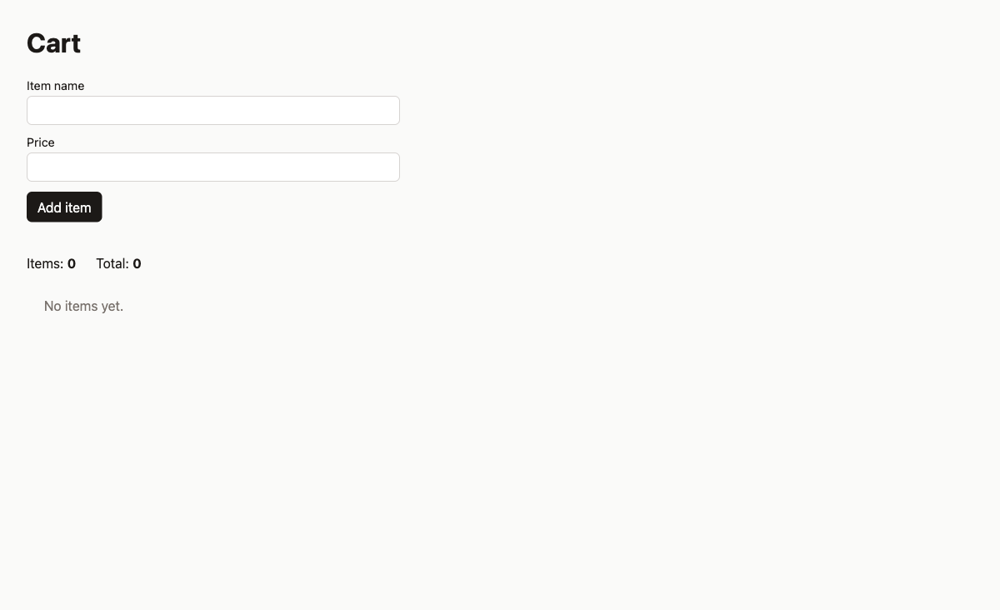
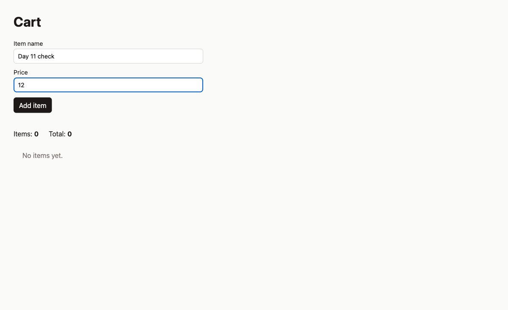
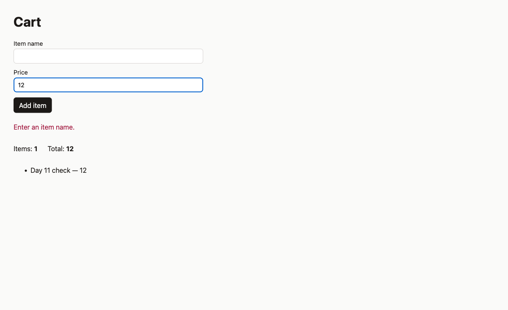
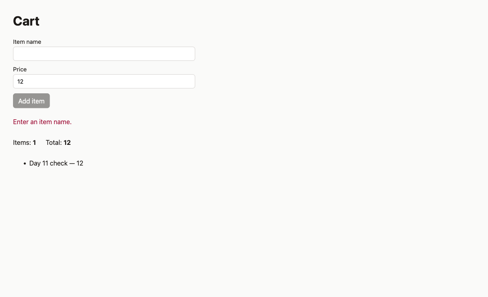

# Day 11 Playwright journey

URL: http://127.0.0.1:4311

The server was restarted before the add step, so the cart started empty (Items 0, Total 0).

## Journey

| Step | Action | Result | Console |
| --- | --- | --- | --- |
| 1 | Open the page | Title "Cart". Items 0, Total 0, "No items yet." Add item is enabled. | 0 messages, 0 errors, 0 warnings |
| 2 | Add "Day 11 check" at price 12 | Items 1, Total 12, list shows "Day 11 check — 12". Page URL becomes `/add`. | 0 messages, 0 errors, 0 warnings |
| 3 | Clear the name, keep price 12, press Enter in Price | Alert "Enter an item name." shows. Items stay 1, Total stays 12. Add item is disabled. Page URL becomes `/add`. | 0 messages, 0 errors, 0 warnings |

Step 2 passed, and step 3 passed. The expected Items 1 and Total 12 after the add matched the page.

## Screenshots

The files are in `claude-training/`, one level above this folder.

### Rerun

The counts in the table above come from this run.

### First run, before the restart

The server still held the earlier cart. Opening the page already showed "Enter an item name.", Items 1, Total 12, and a disabled Add item button. That alert was left from a previous submit.

Editing the price enabled Add item again while the old alert was still on the page.

Submitting the empty name showed the same alert, and Add item was disabled.

## Notes

- The form submits as a full page load to `/add`, not in place.
- Add item is disabled only while the page is showing an error from the last submit. A fresh page with an empty name leaves the button enabled, as in the rerun open screenshot. Editing the name or the price enables the button again, as in the first-run price screenshot. The rerun submitted the empty name with Enter in the Price field.
