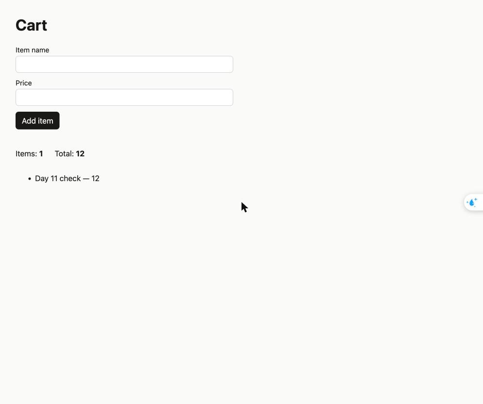

# Day 11 browser check

- URL: http://127.0.0.1:4311
- Console: no errors or exceptions (checked after a reload with tracking on)
- Valid item: name "Day 11 check", price 12, added through the form
  - Result on page: Items: 1, Total: 12
  - List entry: "Day 11 check — 12"
- Empty name (price 12): rejected with "Enter an item name."; count and total stayed at 1 and 12
- Screenshot after the valid item appeared:

