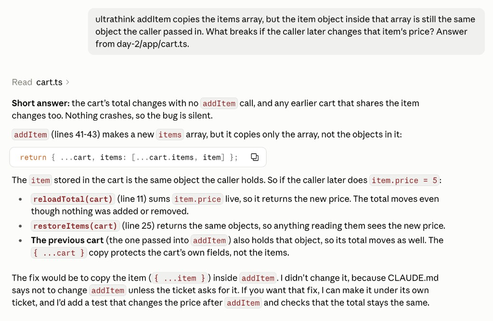
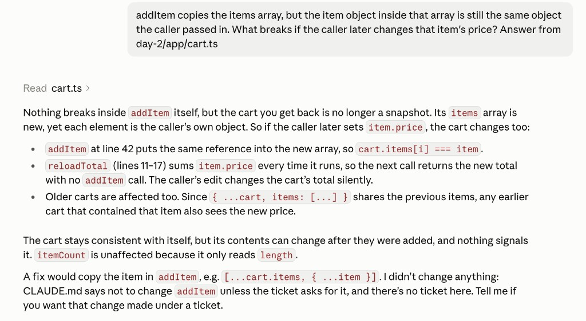

# Ultracode family: deep reasoning only where it pays

Same question, two new Desktop sessions.

```text
addItem copies the items array, but the item object inside that array is still the same object the caller passed in. What breaks if the caller later changes that item's price? Answer from day-2/app/cart.ts.
```

`ultrathink` alone is not a task. It has to sit in front of the question. `/effort low` only sets the level for the next messages. It does not answer the question, so the chat can stay empty after it.

## ultrathink

Send this as one message:

```text
ultrathink addItem copies the items array, but the item object inside that array is still the same object the caller passed in. What breaks if the caller later changes that item's price? Answer from day-2/app/cart.ts.
```

Answer:



The cart total changes with no new `addItem` call, and any earlier cart that shares the item changes too. Nothing crashes, so the bug is silent. `addItem` at lines 41–43 copies the array only (`[...cart.items, item]`). `reloadTotal` sums `item.price` live. `restoreItems` returns the same objects. The `{ ...cart }` copy protects the cart's own fields, not the items. A fix would copy the item with `{ ...item }`. Claude did not change the code, because `CLAUDE.md` says not to change `addItem` unless a ticket asks for it.

## /effort

In a new session, send `/effort low`. Wait until the level is set, then send the question with no `ultrathink`:

```text
addItem copies the items array, but the item object inside that array is still the same object the caller passed in. What breaks if the caller later changes that item's price? Answer from day-2/app/cart.ts.
```

Level picked: low. Typed as `/effort low`. The chat stayed empty after that command, then the question was sent on its own.

Levels the picker showed on this plan: none. This run did not open the picker.

Answer:



Nothing breaks inside `addItem` itself. The returned cart is not a snapshot: the array is new, and each element is still the caller's object, so `cart.items[i] === item`. `reloadTotal` (lines 11–17) returns the new price on the next call. Older carts that share the item see the new price too. `itemCount` is unaffected because it only reads `length`. The same fix was proposed, and the file was left unchanged for the same `CLAUDE.md` reason.

## Comparison

Both answers name the same bug: a later `item.price` change moves totals that were already saved. `ultrathink` leads with that and calls the bug silent. `/effort low` adds that `itemCount` does not move. On this small function the two answers are the same depth.
