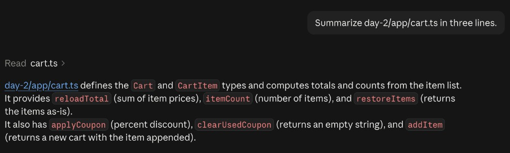

# Remote Control

Desktop session. Send `/rc` in the chat box and accept the one-time confirmation. Connect from the phone at https://claude.ai/code.

## Steer sent from the phone

```text
Summarize day-2/app/cart.ts in three lines.
```

## What came back



Claude read `cart.ts`, then answered in three lines:

- `day-2/app/cart.ts` defines the `Cart` and `CartItem` types and computes totals and counts from the item list.
- It provides `reloadTotal` (sum of item prices), `itemCount` (number of items), and `restoreItems` (returns the items as-is).
- It also has `applyCoupon` (percent discount), `clearUsedCoupon` (returns an empty string), and `addItem` (returns a new cart with the item appended).
